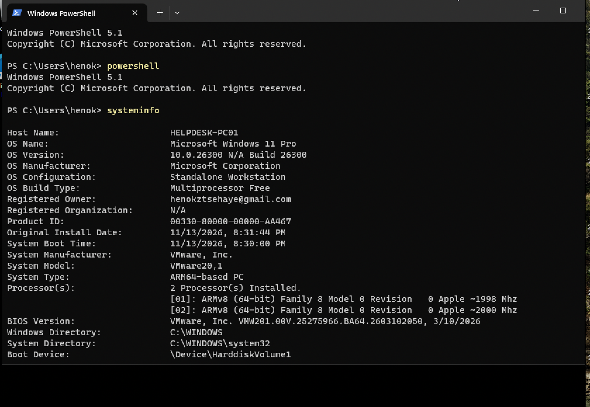
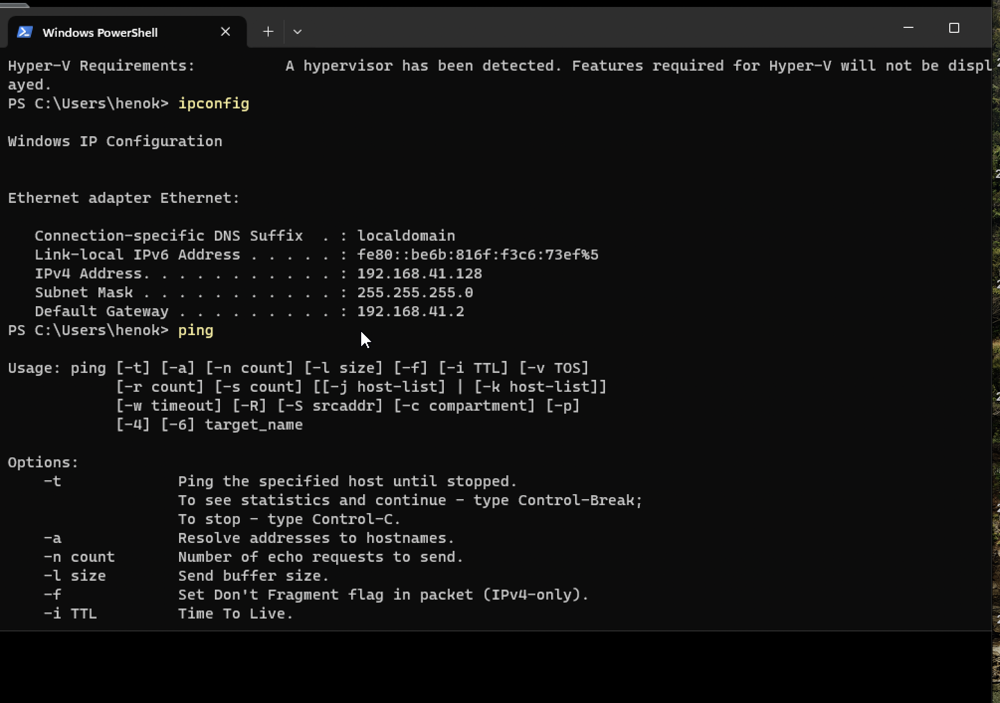
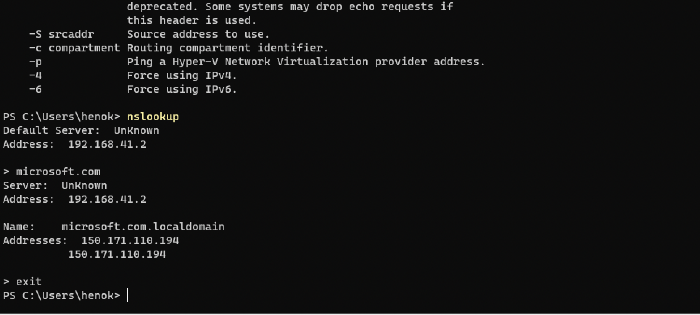

# Lab 01 — Windows 11 System Diagnostics

## Objective
Deploy a Windows 11 virtual machine and practice basic IT support diagnostics.

## Lab Environment
- Apple M3 Mac with 16 GB RAM
- VMware Fusion
- Windows 11 Pro ARM64
- Hostname: HELPDESK-PC01
- VM: 4 GB RAM, 2 virtual processors, 64 GB disk

## Tasks Completed
1. Installed Windows 11 Pro ARM64 in VMware Fusion.
2. Configured the virtual machine and device name.
3. Used `hostname` to identify the workstation.
4. Used `systeminfo` to inspect Windows specifications.
5. Used `ipconfig /all` to inspect network configuration.
6. Used `ping 1.1.1.1` to test IP connectivity.
7. Used `nslookup microsoft.com` to verify DNS resolution.

## Results
- Successfully installed and started Windows 11.
- Identified the workstation and operating system.
- Successfully resolved microsoft.com using DNS.

## Skills Practiced
Windows 11, VMware Fusion, PowerShell, system diagnostics, basic networking, DNS troubleshooting.

## Evidence

### 1. System Information

### 2. Network Configuration

### 3. DNS Lookup

