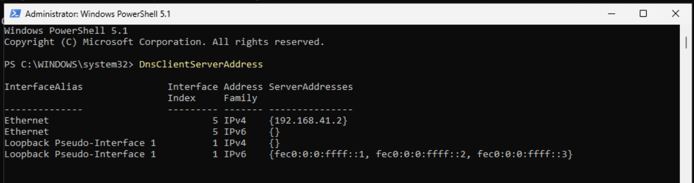
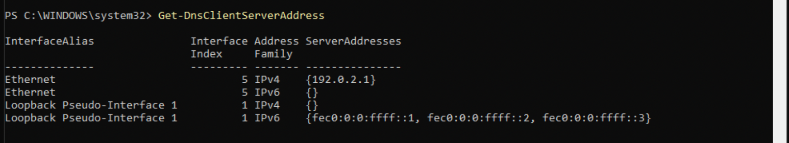
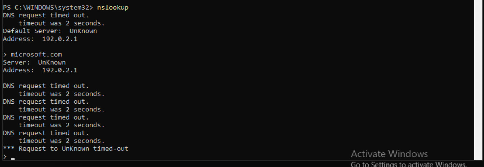
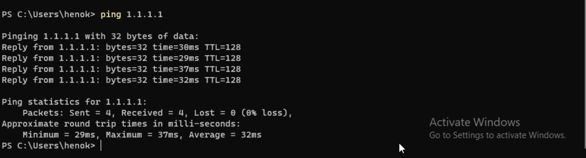
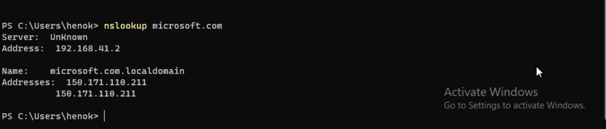

# Lab 02 — DNS Troubleshooting & Repair

## Objective

Simulate, diagnose, and resolve a DNS configuration issue on a Windows 11 virtual machine using basic IT help desk troubleshooting techniques.

## Lab Environment

- Apple M3 Mac with 16 GB RAM
- VMware Fusion
- Windows 11 Pro ARM64
- Hostname: HELPDESK-PC01
- VM: 4 GB RAM, 2 virtual processors, 64 GB disk
- Tools: PowerShell, `nslookup`, `ping`, Windows Network Settings

## Tasks Completed

1. Identified the original DNS configuration using `Get-DnsClientServerAddress`.
2. Confirmed the original DNS server was `192.168.41.2`.
3. Simulated a DNS failure by manually changing the DNS server to `192.0.2.1`.
4. Used `nslookup microsoft.com` to identify DNS request timeouts.
5. Used `ping 1.1.1.1` to verify that IP connectivity was still functioning.
6. Identified the incorrectly configured DNS server as the cause of the resolution failure.
7. Restored DNS server assignment to Automatic (DHCP).
8. Used `nslookup microsoft.com` to verify successful DNS resolution.

## Troubleshooting Process

### Step 1 — Identify Original DNS Settings

Used PowerShell to inspect the network adapter's DNS configuration.

`Get-DnsClientServerAddress`

The Ethernet adapter was originally using DNS server `192.168.41.2` through automatic configuration.

### Step 2 — Simulate DNS Failure

Changed the preferred DNS server to `192.0.2.1` through Windows Network Settings.

This simulated an unavailable DNS server.

### Step 3 — Diagnose DNS Resolution

Executed:

`nslookup microsoft.com`

The DNS lookup repeatedly timed out, indicating that the configured DNS server was not responding.

### Step 4 — Test Network Connectivity

Executed:

`ping 1.1.1.1`

Results:

- Packets sent: 4
- Packets received: 4
- Packet loss: 0%
- Average response time: 32 ms

This confirmed that basic IP connectivity was working even though DNS resolution was failing.

### Step 5 — Repair DNS Configuration

Navigated to Windows Network Settings and changed DNS server assignment back to Automatic (DHCP).

The original DNS server `192.168.41.2` was restored.

### Step 6 — Verify Successful Repair

Executed:

`nslookup microsoft.com`

The DNS lookup successfully returned an IP address, confirming that DNS resolution was functioning again.

## Root Cause

The network adapter was manually configured to use an unavailable DNS server (`192.0.2.1`).

This prevented successful domain name resolution while basic IP connectivity remained functional.

## Resolution

Restored automatic DNS configuration through Windows Network Settings and verified successful name resolution using `nslookup`.

**Final Status: Resolved**

## Skills Demonstrated

- Windows 11 network troubleshooting
- PowerShell diagnostics
- DNS configuration and repair
- IP connectivity testing
- DNS lookup testing
- Root cause analysis
- Technical documentation
- Troubleshooting verification

## Key Takeaways

This lab demonstrated how DNS failures can prevent domain name resolution even when basic network connectivity is functioning.

By using `nslookup` and `ping`, I was able to isolate the problem, identify the incorrect DNS configuration, restore the original settings, and verify the repair.
