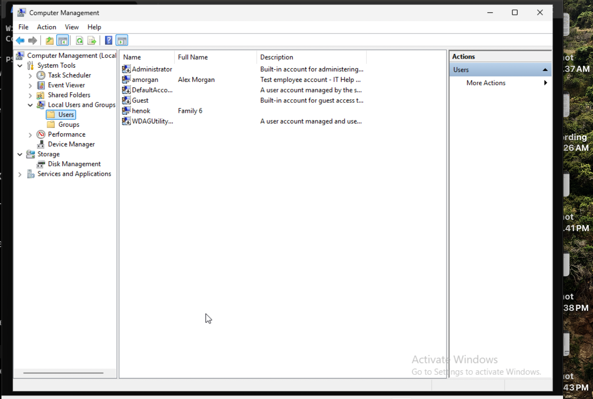

# Lab 03 — Windows 11 User Account Management

## Objective

Create and manage local Windows 11 user accounts while practicing common IT help desk tasks, including password resets, user permissions, administrator access, and account activation.

## Lab Environment

- Apple M3 Mac with 16 GB RAM
- VMware Fusion
- Windows 11 Pro ARM64
- Hostname: HELPDESK-PC01
- VM: 4 GB RAM, 2 virtual processors, 64 GB disk
- Tools: Computer Management, Local Users and Groups

## Tasks Completed

1. Opened Computer Management and navigated to Local Users and Groups.
2. Created a new employee account with the username `amorgan`.
3. Verified that the new account belonged to the standard `Users` group.
4. Simulated an employee password reset using the Set Password feature.
5. Granted temporary administrator permissions by adding the account to the `Administrators` group.
6. Removed administrator permissions and restored standard user access.
7. Disabled the employee account to simulate employee offboarding.
8. Re-enabled the employee account to restore access.
9. Verified account settings and documented the completed tasks.

## Account Management Process

### Step 1 — Create a New Employee Account

Opened Computer Management and navigated to:

`System Tools → Local Users and Groups → Users`

Created a new local employee account.

- **Username:** `amorgan`
- **Full Name:** Alex Morgan
- **Account Type:** Standard User
- **Description:** Test employee account - IT Help Desk Lab 3

### Step 2 — Verify Standard User
