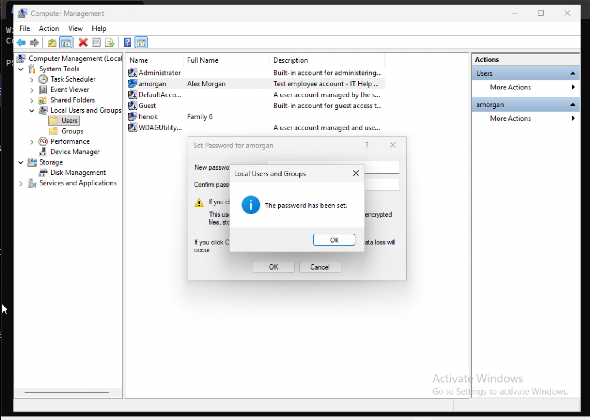
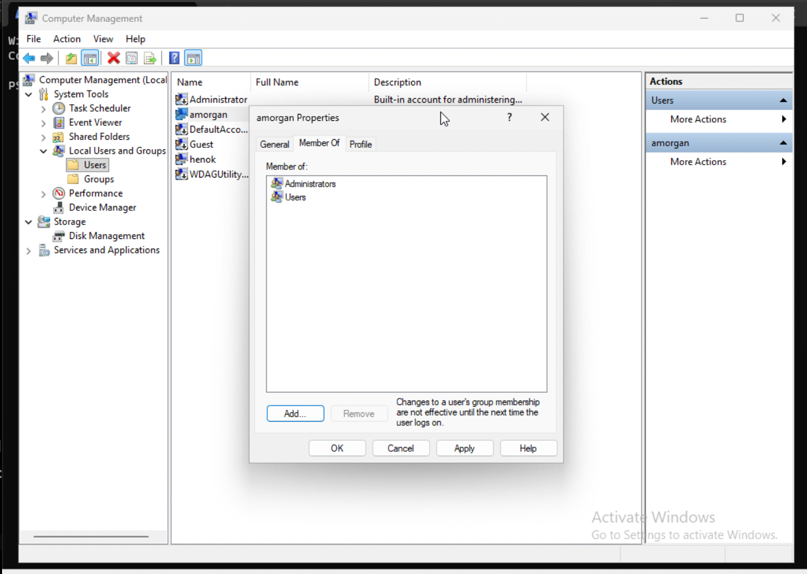
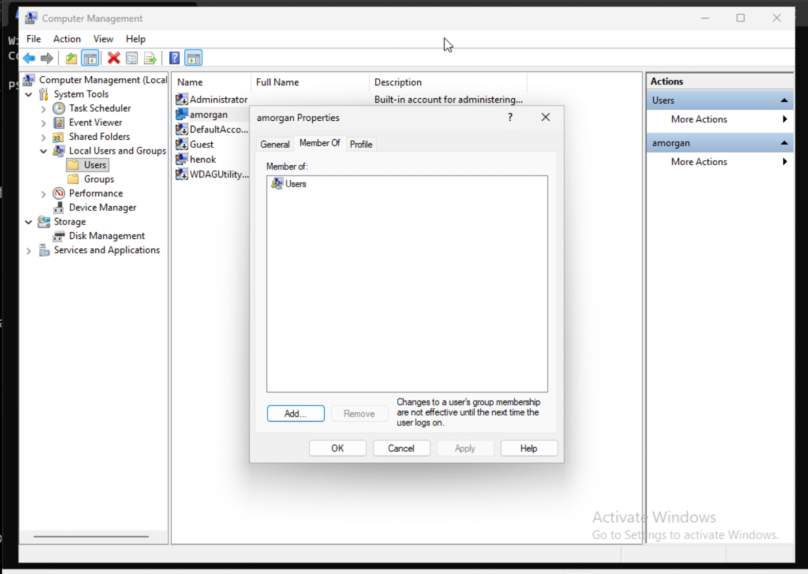
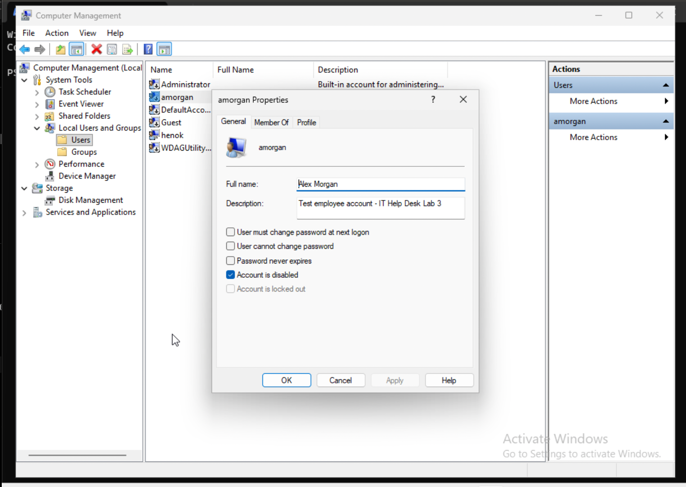

# Lab 03 — Windows 11 User Account Management

## Objective

Create and manage local Windows 11 user accounts while practicing common IT help desk tasks, including password resets, user permissions, administrator access, and account activation.

## Lab Environment

- Apple M3 Mac with 16 GB RAM
- VMware Fusion
- Windows 11 Pro ARM64
- Hostname: HELPDESK-PC01
- VM: 4 GB RAM, 2 virtual processors, 64 GB disk
- Tools: Computer Management, Local Users and Groups

## Tasks Completed

1. Opened Computer Management and navigated to Local Users and Groups.
2. Created a new employee account with the username `amorgan`.
3. Verified that the new account belonged to the standard `Users` group.
4. Simulated an employee password reset using the Set Password feature.
5. Granted temporary administrator permissions by adding the account to the `Administrators` group.
6. Removed administrator permissions and restored standard user access.
7. Disabled the employee account to simulate employee offboarding.
8. Re-enabled the employee account to restore access.
9. Verified account settings and documented the completed tasks.

## Account Management Process

### Step 1 — Create a New Employee Account

Opened Computer Management and navigated to:

`System Tools → Local Users and Groups → Users`

Created a new local employee account.

- **Username:** `amorgan`
- **Full Name:** Alex Morgan
- **Account Type:** Standard User
- **Description:** Test employee account - IT Help Desk Lab 3

### Step 2 — Verify Standard User Permissions

Opened the account's Properties window and selected the **Member Of** tab.

Confirmed that the account belonged to the `Users` group and did not have administrator permissions.

### Step 3 — Reset Employee Password

Simulated a help desk request from an employee who forgot their password.

Right-clicked the employee account, selected **Set Password**, and assigned a new temporary practice password.

This demonstrated how an IT support technician can perform a local account password reset.

### Step 4 — Grant Administrator Permissions

Opened the employee account's Properties window and selected the **Member Of** tab.

Added the account to the `Administrators` group.

Verified that the account belonged to both:

- `Users`
- `Administrators`

### Step 5 — Remove Administrator Permissions

Removed the employee account from the `Administrators` group.

Verified that the account belonged only to the `Users` group.

This demonstrated the principle of least privilege, ensuring that users have only the access necessary for their responsibilities.

### Step 6 — Disable Employee Account

Simulated an employee leaving the organization.

Opened the account's Properties window and checked **Account is disabled**.

This prevented the account from being used for new sign-ins without deleting the account.

### Step 7 — Re-enable Employee Account

Returned to the employee account's Properties window and unchecked **Account is disabled**.

Verified that the account was enabled again.

## Troubleshooting Scenarios

### Scenario 1 — Employee Forgot Password

**Issue:** An employee cannot remember their Windows account password.

**Resolution:** Reset the local account password through Computer Management.

### Scenario 2 — Employee Requires Elevated Permissions

**Issue:** An employee requires temporary administrator access for an authorized task.

**Resolution:** Add the account to the Administrators group, then remove the elevated permissions when no longer required.

### Scenario 3 — Employee Leaves the Organization

**Issue:** An employee's Windows account must be disabled.

**Resolution:** Disable the local account to prevent new sign-ins while preserving the account for administrative purposes.

## Skills Demonstrated

- Windows 11 user account administration
- Local Users and Groups management
- Employee account creation
- Password resets
- Standard user and administrator permissions
- Group membership management
- Principle of least privilege
- Employee onboarding and offboarding simulations
- Account disabling and re-enabling
- Technical documentation

## Key Takeaways

This lab demonstrated how IT help desk technicians manage local Windows accounts throughout the employee account lifecycle.

I gained hands-on experience creating accounts, resetting passwords, modifying group memberships, removing unnecessary administrator access, and disabling and re-enabling accounts.

These tasks reinforced the importance of account security, access control, and proper user administration in an IT support environment.

---

**Lab Status:** Completed  
**Project Type:** Personal IT Help Desk Homelab  
**Environment:** Windows 11 Pro ARM64 — VMware Fusion
