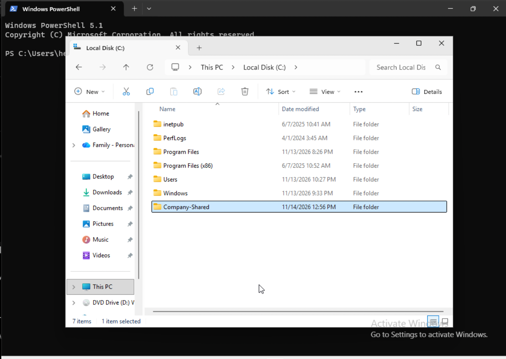
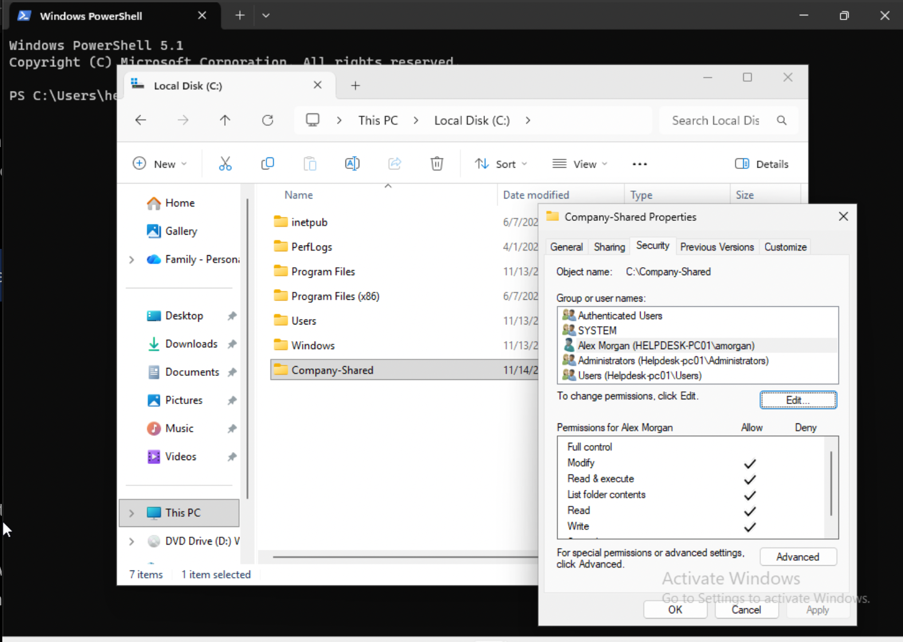
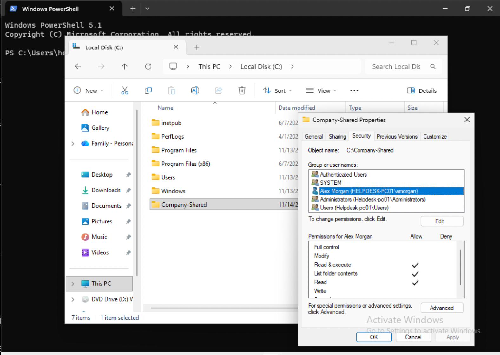
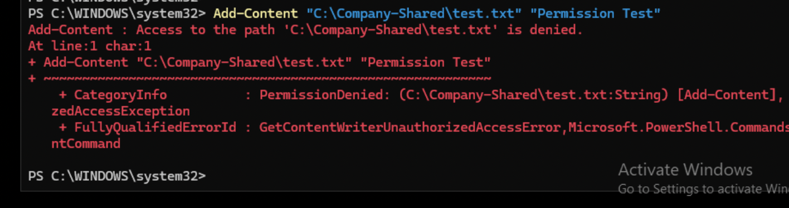
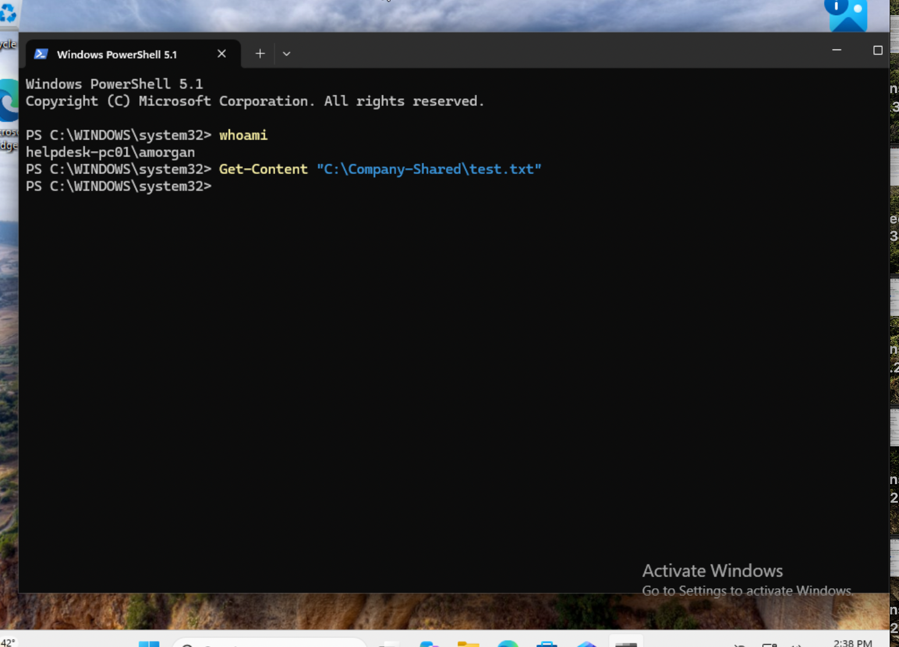

# Lab 04 — Windows File Permissions & Access Control

## Objective
Configure and troubleshoot Windows NTFS file permissions to control user access to company resources and verify that authorized users have the appropriate level of access.

## Lab Environment
- **Operating System:** Windows 11 Pro ARM64
- **Virtualization:** VMware Fusion
- **Host Computer:** Apple Silicon Mac
- **Computer Name:** HELPDESK-PC01
- **Test User:** Alex Morgan (`amorgan`)
- **Tools:** File Explorer, Windows Security Properties, Advanced Security Settings, Windows PowerShell

## Scenario
A company employee, Alex Morgan, requires access to a shared company folder. The IT help desk must configure permissions that allow the employee to read files while preventing unauthorized modifications.

## Troubleshooting and Configuration Process

### 1. Create the Company Folder
Created a folder at `C:\Company-Shared` to simulate a company resource.

### 2. Inspect Original Permissions
Opened the folder's Properties → Security tab to review existing NTFS permissions and security groups.

### 3. Configure Employee Access
Added the local employee account `HELPDESK-PC01\amorgan` and configured permissions for Alex Morgan.

### 4. Restrict File Permissions
Modified permissions to limit the employee's ability to write to the test file while preserving read access.

### 5. Verify Write Access Is Denied
Opened PowerShell as Alex Morgan and attempted to modify `C:\Company-Shared\test.txt` using `Add-Content`.

**Result:** PowerShell returned an Access Denied error, confirming that the employee could not modify the protected file.

### 6. Verify Read Access
Executed the following PowerShell commands under Alex Morgan's account:

`whoami`

`Get-Content "C:\Company-Shared\test.txt"`

**Result:** Confirmed the active user was `HELPDESK-PC01\amorgan`. The file was accessible without errors. Because the file was empty, the command produced no content.

## Root Cause
The original permission configuration allowed broader modification access than intended. NTFS permission inheritance also affected the file's effective permissions.

## Resolution
Adjusted NTFS permissions and inheritance on the test file to restrict modification access while retaining read access for the employee.

## Skills Demonstrated
- Windows NTFS permission management
- Local user access configuration
- File and folder security
- Permission inheritance troubleshooting
- PowerShell access verification
- Least-privilege access control
- Troubleshooting Access Denied errors
- Technical documentation

## Conclusion
Successfully configured and tested Windows file permissions using a simulated employee account. Verified that the employee could read the protected file while modification attempts were denied.
