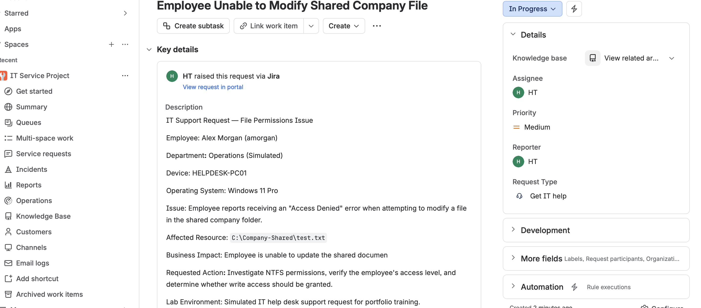
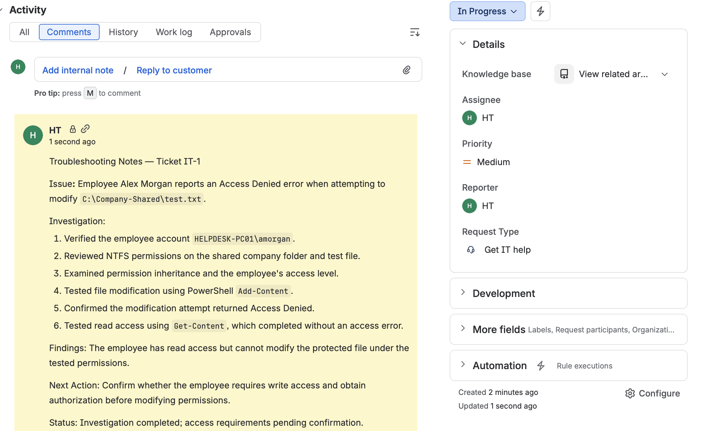
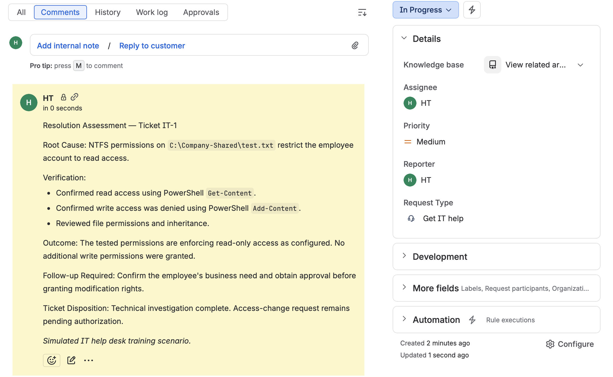
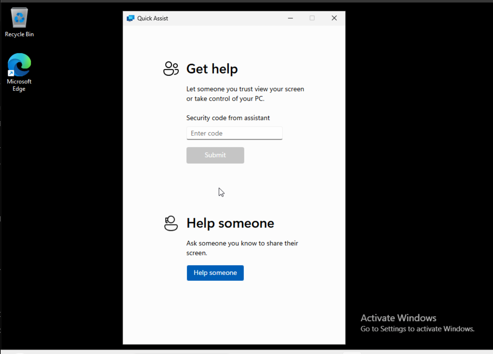
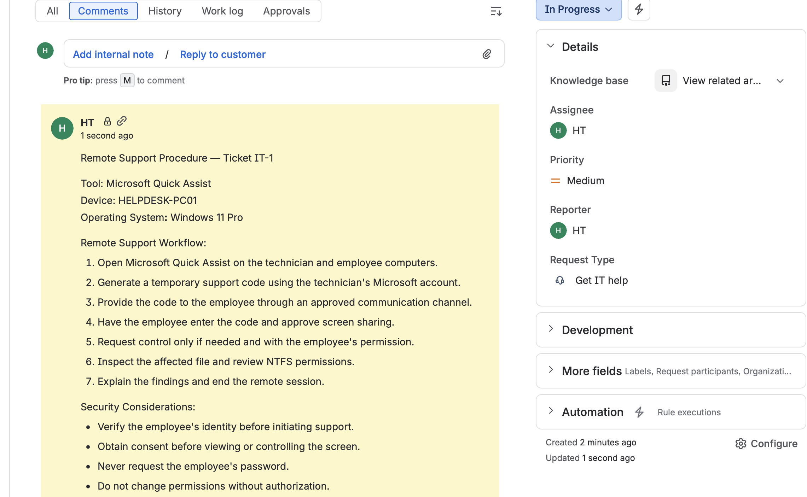
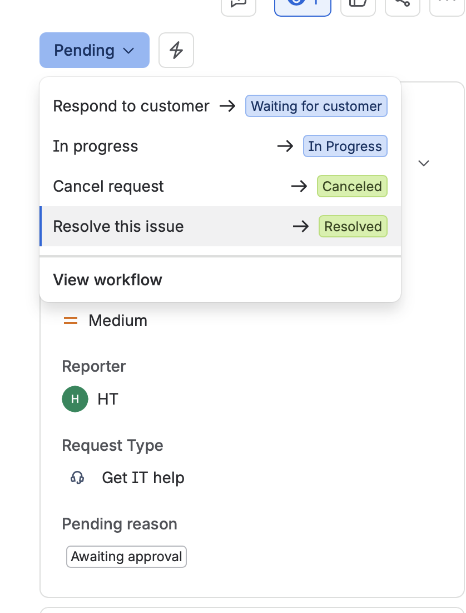

# Lab 05 — Help Desk Ticketing & Remote Support

## Objective
Simulate a Tier 1 IT help desk workflow using Jira Service Management to create, prioritize, investigate, document, and manage an employee support request.

## Lab Environment
- **Ticketing Platform:** Jira Service Management
- **Operating System:** Windows 11 Pro ARM64
- **Virtualization:** VMware Fusion
- **Computer:** HELPDESK-PC01
- **Remote Support Tool:** Microsoft Quick Assist (workflow documentation)
- **Ticket ID:** IT-1
- **Employee:** Alex Morgan (simulated)

## Scenario
An employee reported receiving an "Access Denied" error when attempting to modify a file in the company shared folder.

**Affected Resource:** `C:\Company-Shared\test.txt`

The help desk technician was responsible for investigating the issue, documenting findings, and determining the appropriate next steps.

## Troubleshooting Process

### 1. Create and Assign Support Ticket
Created ticket IT-1 in Jira Service Management.

- **Request Type:** Get IT help
- **Priority:** Medium
- **Assignee:** Assigned to myself
- **Initial Status:** Waiting for support
- **Working Status:** In Progress

### 2. Document Troubleshooting
Added a private internal note documenting the investigation.

- Verified the employee account `HELPDESK-PC01\amorgan`.
- Reviewed NTFS file permissions.
- Examined permission inheritance.
- Tested write access using PowerShell `Add-Content`.
- Verified read access using `Get-Content`.

**Finding:** The employee could read the protected file but could not modify it.

### 3. Record Resolution Assessment
Documented the root cause and investigation outcome.

The file's NTFS permissions restricted write access. No additional permissions were granted because authorization had not been established.

### 4. Remote Support Procedure
Reviewed the Microsoft Quick Assist remote-support workflow.

The documented process included verifying the employee's identity, obtaining consent, initiating screen sharing, inspecting the affected resource, and ending the session securely.

No live remote-control session was performed.

### 5. Manage Pending Approval
Updated the Jira ticket to reflect the outstanding authorization requirement.

- **Status:** Pending
- **Pending Reason:** Awaiting approval

The ticket was left unresolved because the employee's requested modification rights had not been approved.

## Skills Demonstrated
- IT help desk ticket creation
- Jira Service Management
- Ticket assignment and prioritization
- Incident and service request documentation
- Windows NTFS permissions troubleshooting
- Internal technician notes
- Remote-support workflow knowledge
- Access approval and escalation awareness
- Ticket lifecycle management

## Conclusion
Successfully simulated a Tier 1 help desk support workflow using Jira Service Management. Investigated a Windows file permissions issue, documented the findings, and placed the request in Pending status while awaiting authorization.

This lab demonstrates practical ticketing and troubleshooting documentation skills in a simulated IT support environment.
