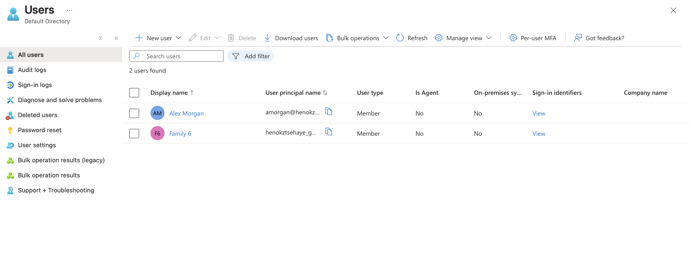
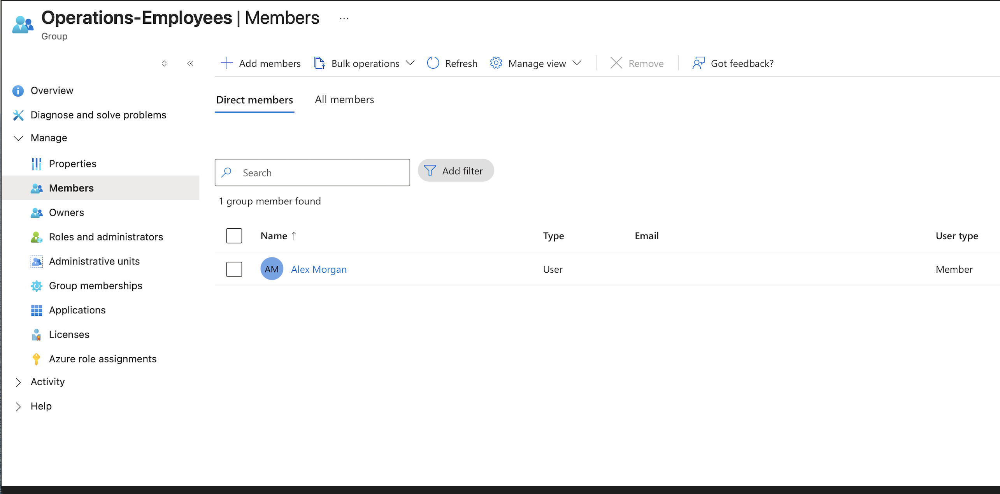
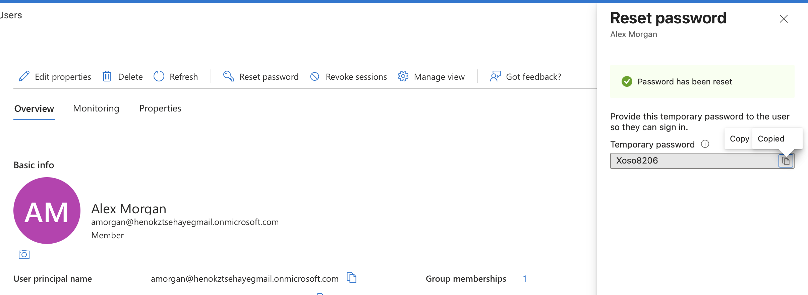
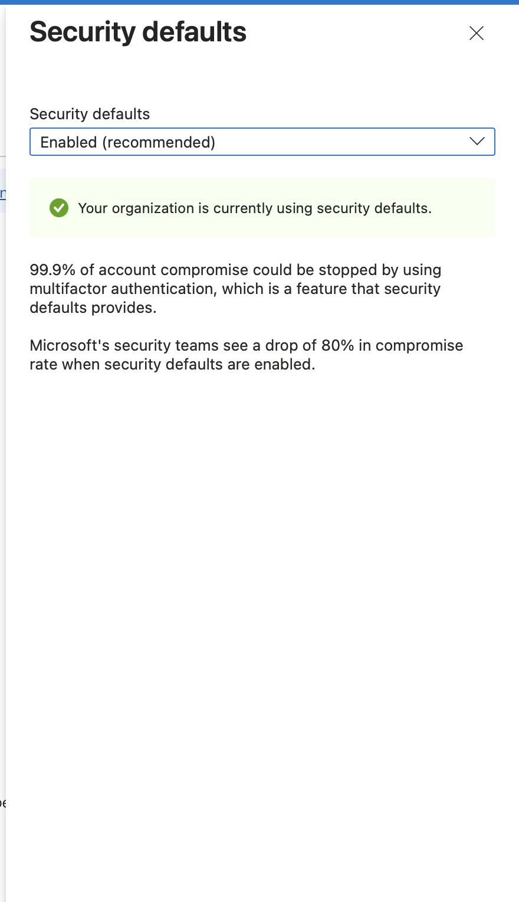
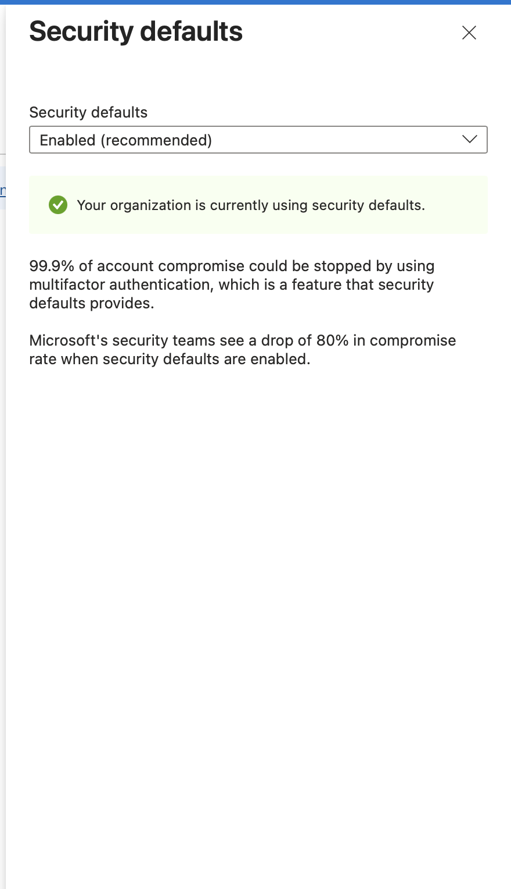
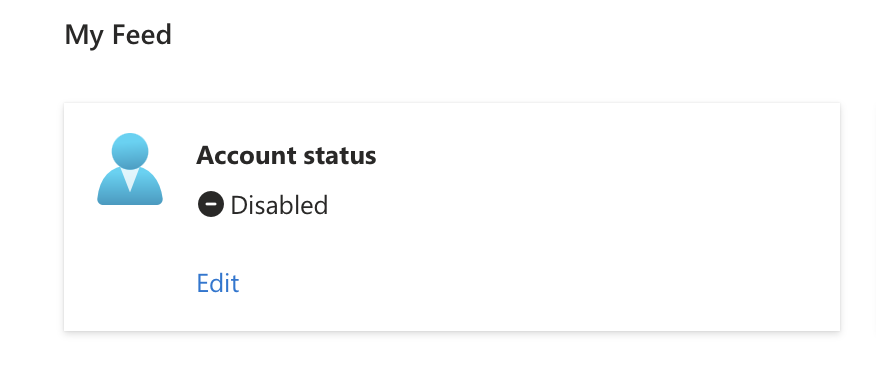

# Lab 06 — Microsoft Entra ID Administration

## Objective
Simulate common Tier 1 IT Help Desk responsibilities using Microsoft Entra ID, including employee account provisioning, security group management, password resets, identity security review, and employee offboarding.

## Lab Environment
- **Platform:** Microsoft Azure / Microsoft Entra ID
- **Directory:** Microsoft Entra ID Free
- **Environment:** Personal Azure lab tenant
- **Administration:** Microsoft Entra Admin Center
- **Test Employee:** Alex Morgan (`amorgan`)
- **Security Group:** Operations-Employees

## Scenario
A fictional company needs to onboard an employee into its Operations department, manage their account access, review identity security protections, and eventually disable the account during employee offboarding.

## Lab Procedures

### 1. Employee Account Provisioning
Created a simulated employee account named Alex Morgan in Microsoft Entra ID.

- Created a cloud-based user identity.
- Assigned the employee a user principal name.
- Verified the account appeared under All Users.

### 2. Security Group Management
Created a security group named `Operations-Employees` and added Alex Morgan as a direct member.

- Configured a security group with assigned membership.
- Added the employee to the group.
- Verified membership through the group's Members page.

### 3. Password Reset
Performed an administrative password reset for the simulated employee account.

- Located the employee in Microsoft Entra ID.
- Initiated a password reset.
- Followed the administrative account recovery workflow.
- Kept temporary credentials private.

### 4. Multifactor Authentication Review
Reviewed legacy per-user MFA settings for the test account.

- Opened the per-user multifactor authentication management page.
- Verified the employee's legacy per-user MFA status was Disabled.
- Identified that legacy per-user MFA status does not necessarily reflect tenant-wide MFA requirements.

### 5. Tenant Security Defaults
Reviewed the Microsoft Entra tenant's Security Defaults configuration.

- Located the tenant-wide Security Defaults settings.
- Verified that Security Defaults were enabled.
- Reviewed how these settings provide baseline identity protections, including MFA requirements.

No changes were made to the existing Security Defaults configuration.

### 6. Employee Offboarding
Simulated an employee leaving the company by disabling Alex Morgan's account.

- Opened the employee's account properties.
- Disabled the account.
- Verified the account status displayed Disabled.
- Preserved the account record instead of deleting it.

## Skills Demonstrated
- Microsoft Entra ID administration
- Cloud-based user provisioning
- Identity and access management (IAM)
- Security group creation and membership management
- Administrative password resets
- Multifactor authentication concepts
- Microsoft Entra Security Defaults
- Employee onboarding and offboarding
- Account access revocation
- Technical documentation

## Conclusion
Successfully completed a simulated cloud identity administration workflow using Microsoft Entra ID. Created and managed an employee account, configured security group membership, performed a password reset, reviewed MFA-related security settings, and disabled the account during offboarding.

This lab demonstrates foundational cloud identity management skills relevant to entry-level IT Help Desk and Service Desk Technician positions.
